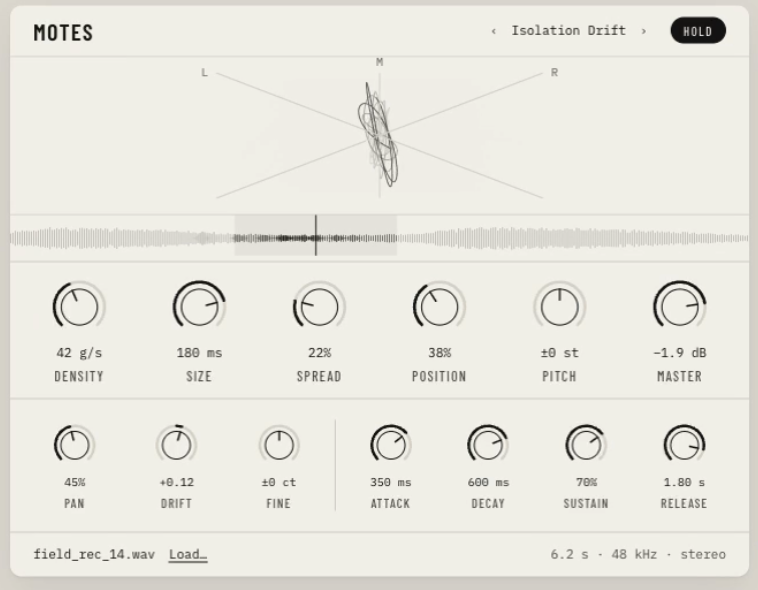

# Motes

A polyphonic granular sample-as-synth for Ableton Live. Load a sample, play it from MIDI, and shape the grain cloud
with 13 parameters. Native Apple Silicon (arm64), AU and VST3.



The editor shows what the engine is actually doing:

- **Phase scope** — a live stereo goniometer of the real output.
- **Source strip** — the sample's waveform, with the spread band, the playhead of each sounding voice, and a flash for every grain as it is cut.
- **13 knobs** — Density, Size, Spread, Position, Pitch, Master, Pan, Drift, Fine, Attack, Decay, Sustain, Release. Drag, Shift to fine-tune, double-click to reset.
- **Header** — factory presets (‹ ›) and **HOLD**, which latches a note so you can audition without MIDI.
- **Load…** or drop a WAV onto the scope or strip.

## Build

macOS, Apple Silicon, CMake and the Command Line Tools (full Xcode is not required). JUCE is a submodule.

```bash
git submodule update --init
cmake -B build -G "Unix Makefiles" -DCMAKE_BUILD_TYPE=Release
cmake --build build
```

A build installs the AU and VST3 into `~/Library/Audio/Plug-Ins/`. Validate the AU with `auval -v aumu Mote Hntr`.

`git status` will show ` m JUCE`. That is intentional: the JUCE submodule is pinned to upstream 7.0.12 and a small patch
(`patches/`, a macOS 15 SDK fix) is applied at configure time. Don't commit it.

## Tests

```bash
cmake --build build --target test_core test_format
ctest --test-dir build --output-on-failure
```

`test_core` covers the portable C11 engine in `src/core/`; `test_format` covers the editor's value formatting.

There is also an optional headless harness for the editor and the audio/GUI seam (`-DMOTES_BUILD_HARNESS=ON`, off by
default): `motes_harness --selftest`, or `--snapshot out.png` to render the editor without a host.

## Layout

- `src/core/` — the DSP engine: portable C11 with no JUCE dependency, exposed through a small C ABI.
- `src/plugin/` — the JUCE shell: processor, editor and components.
- `assets/fonts/` — Barlow Condensed and IBM Plex Mono (SIL OFL; licenses alongside).
- `docs/` — design notes, plans, and the editor's reference capture.
